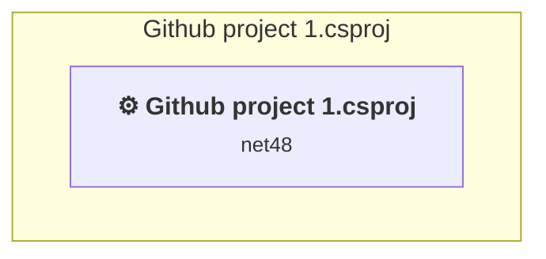

# Projects and dependencies analysis

This document provides a comprehensive overview of the projects and their dependencies in the context of upgrading to .NETCoreApp,Version=v10.0.

## Table of Contents

- [Executive Summary](#executive-Summary)
  - [Highlevel Metrics](#highlevel-metrics)
  - [Projects Compatibility](#projects-compatibility)
  - [Package Compatibility](#package-compatibility)
  - [API Compatibility](#api-compatibility)
  - [Binding Redirect Configuration](#binding-redirect-configuration)
- [Aggregate NuGet packages details](#aggregate-nuget-packages-details)
- [Top API Migration Challenges](#top-api-migration-challenges)
  - [Technologies and Features](#technologies-and-features)
  - [Most Frequent API Issues](#most-frequent-api-issues)
- [Projects Relationship Graph](#projects-relationship-graph)
- [Project Details](#project-details)

  - [Github project 1\Github project 1.csproj](#github-project-1github-project-1csproj)

## Executive Summary

### Highlevel Metrics

| Metric | Count | Status |
| :--- | :---: | :--- |
| Total Projects | 1 | All require upgrade |
| Total NuGet Packages | 10 | 4 need upgrade |
| Total Code Files | 9 |  |
| Total Code Files with Incidents | 7 |  |
| Total Lines of Code | 418 |  |
| Total Number of Issues | 117 |  |
| Estimated LOC to modify | 98+ | at least 23.4% of codebase |

### Projects Compatibility

| Project | Target Framework | Difficulty | Package Issues | API Issues | Binding Issues | Est. LOC Impact | Description |
| :--- | :---: | :---: | :---: | :---: | :---: | :---: | :--- |
| [Github project 1\Github project 1.csproj](#github-project-1github-project-1csproj) | net48 | 🔴 High | 12 | 98 | 0 | 98+ | Wap, Sdk Style = False |

### Package Compatibility

| Status | Count | Percentage |
| :--- | :---: | :---: |
| ✅ Compatible | 6 | 60.0% |
| ⚠️ Incompatible | 3 | 30.0% |
| 🔄 Upgrade Recommended | 1 | 10.0% |
| ***Total NuGet Packages*** | ***10*** | ***100%*** |

### API Compatibility

| Category | Count | Impact |
| :--- | :---: | :--- |
| 🔴 Binary Incompatible | 51 | High - Require code changes |
| 🟡 Source Incompatible | 47 | Medium - Needs re-compilation and potential conflicting API error fixing |
| 🔵 Behavioral change | 0 | Low - Behavioral changes that may require testing at runtime |
| ✅ Compatible | 85 |  |
| ***Total APIs Analyzed*** | ***183*** |  |

## Aggregate NuGet packages details

| Package | Current Version | Suggested Version | Projects | Description |
| :--- | :---: | :---: | :--- | :--- |
| Microsoft.AspNet.Mvc | 4.0.20710.0 |  | [Github project 1.csproj](#github-project-1github-project-1csproj) | NuGet package functionality is included with framework reference |
| Microsoft.AspNet.Razor | 2.0.20710.0 |  | [Github project 1.csproj](#github-project-1github-project-1csproj) | NuGet package functionality is included with framework reference |
| Microsoft.AspNet.WebApi | 4.0.20710.0 |  | [Github project 1.csproj](#github-project-1github-project-1csproj) | NuGet package functionality is included with framework reference |
| Microsoft.AspNet.WebApi.Client | 4.0.20710.0 | 6.0.0 | [Github project 1.csproj](#github-project-1github-project-1csproj) | ⚠️NuGet package is incompatible |
| Microsoft.AspNet.WebApi.Core | 4.0.20710.0 |  | [Github project 1.csproj](#github-project-1github-project-1csproj) | ⚠️NuGet package is incompatible |
| Microsoft.AspNet.WebApi.WebHost | 4.0.20710.0 |  | [Github project 1.csproj](#github-project-1github-project-1csproj) | ⚠️NuGet package is incompatible |
| Microsoft.AspNet.WebPages | 2.0.20710.0 |  | [Github project 1.csproj](#github-project-1github-project-1csproj) | NuGet package functionality is included with framework reference |
| Microsoft.Net.Http | 2.0.20710.0 |  | [Github project 1.csproj](#github-project-1github-project-1csproj) | Needs to be replaced with Replace with new package System.Net.Http=4.3.4 |
| Microsoft.Web.Infrastructure | 1.0.0.0 |  | [Github project 1.csproj](#github-project-1github-project-1csproj) | NuGet package functionality is included with framework reference |
| Newtonsoft.Json | 4.5.6 | 13.0.4 | [Github project 1.csproj](#github-project-1github-project-1csproj) | NuGet package upgrade is recommended |

## Top API Migration Challenges

### Technologies and Features

| Technology | Issues | Percentage | Migration Path |
| :--- | :---: | :---: | :--- |
| ASP.NET Framework (System.Web) | 53 | 54.1% | Legacy ASP.NET Framework APIs for web applications (System.Web.*) that don't exist in ASP.NET Core due to architectural differences. ASP.NET Core represents a complete redesign of the web framework. Migrate to ASP.NET Core equivalents or consider System.Web.Adapters package for compatibility. |

### Most Frequent API Issues

| API | Count | Percentage | Category |
| :--- | :---: | :---: | :--- |
| T:System.Web.Mvc.ActionResult | 4 | 4.1% | Binary Incompatible |
| M:System.Data.SqlClient.SqlConnection.Open | 4 | 4.1% | Source Incompatible |
| P:System.Data.SqlClient.SqlCommand.CommandType | 4 | 4.1% | Source Incompatible |
| T:System.Data.SqlClient.SqlCommand | 4 | 4.1% | Source Incompatible |
| M:System.Data.SqlClient.SqlCommand.#ctor(System.String,System.Data.SqlClient.SqlConnection) | 4 | 4.1% | Source Incompatible |
| T:System.Data.SqlClient.SqlConnection | 4 | 4.1% | Source Incompatible |
| M:System.Data.SqlClient.SqlConnection.#ctor(System.String) | 4 | 4.1% | Source Incompatible |
| T:System.Web.Mvc.RedirectToRouteResult | 3 | 3.1% | Binary Incompatible |
| M:System.Web.Mvc.Controller.RedirectToAction(System.String) | 3 | 3.1% | Binary Incompatible |
| M:System.Data.SqlClient.SqlCommand.ExecuteNonQuery | 3 | 3.1% | Source Incompatible |
| T:System.Data.SqlClient.SqlParameterCollection | 3 | 3.1% | Source Incompatible |
| P:System.Data.SqlClient.SqlCommand.Parameters | 3 | 3.1% | Source Incompatible |
| T:System.Data.SqlClient.SqlParameter | 3 | 3.1% | Source Incompatible |
| M:System.Data.SqlClient.SqlParameterCollection.AddWithValue(System.String,System.Object) | 3 | 3.1% | Source Incompatible |
| P:System.Data.SqlClient.SqlDataReader.Item(System.String) | 3 | 3.1% | Source Incompatible |
| T:System.Web.Http.RouteParameter | 3 | 3.1% | Binary Incompatible |
| T:System.Web.Mvc.UrlParameter | 3 | 3.1% | Binary Incompatible |
| T:System.Web.Http.HttpConfiguration | 2 | 2.0% | Binary Incompatible |
| T:System.Web.Routing.RouteCollection | 2 | 2.0% | Binary Incompatible |
| T:System.Web.Mvc.GlobalFilterCollection | 2 | 2.0% | Binary Incompatible |
| T:System.Web.Mvc.RouteCollectionExtensions | 2 | 2.0% | Binary Incompatible |
| M:System.Web.Mvc.HttpPostAttribute.#ctor | 1 | 1.0% | Binary Incompatible |
| T:System.Web.Mvc.HttpPostAttribute | 1 | 1.0% | Binary Incompatible |
| T:System.Web.Mvc.ViewResult | 1 | 1.0% | Binary Incompatible |
| M:System.Web.Mvc.Controller.View(System.Object) | 1 | 1.0% | Binary Incompatible |
| M:System.Web.Mvc.Controller.#ctor | 1 | 1.0% | Binary Incompatible |
| T:System.Web.Mvc.Controller | 1 | 1.0% | Binary Incompatible |
| M:System.Data.SqlClient.SqlDataReader.Read | 1 | 1.0% | Source Incompatible |
| T:System.Data.SqlClient.SqlDataReader | 1 | 1.0% | Source Incompatible |
| M:System.Data.SqlClient.SqlCommand.ExecuteReader | 1 | 1.0% | Source Incompatible |
| F:System.Web.Http.RouteParameter.Optional | 1 | 1.0% | Binary Incompatible |
| T:System.Web.Http.HttpRouteCollection | 1 | 1.0% | Binary Incompatible |
| P:System.Web.Http.HttpConfiguration.Routes | 1 | 1.0% | Binary Incompatible |
| T:System.Web.Http.HttpRouteCollectionExtensions | 1 | 1.0% | Binary Incompatible |
| T:System.Web.Http.Routing.IHttpRoute | 1 | 1.0% | Binary Incompatible |
| M:System.Web.Http.HttpRouteCollectionExtensions.MapHttpRoute(System.Web.Http.HttpRouteCollection,System.String,System.String,System.Object) | 1 | 1.0% | Binary Incompatible |
| T:System.Web.Routing.RouteTable | 1 | 1.0% | Binary Incompatible |
| P:System.Web.Routing.RouteTable.Routes | 1 | 1.0% | Binary Incompatible |
| T:System.Web.Mvc.GlobalFilters | 1 | 1.0% | Binary Incompatible |
| P:System.Web.Mvc.GlobalFilters.Filters | 1 | 1.0% | Binary Incompatible |
| T:System.Web.Http.GlobalConfiguration | 1 | 1.0% | Binary Incompatible |
| P:System.Web.Http.GlobalConfiguration.Configuration | 1 | 1.0% | Binary Incompatible |
| T:System.Web.Mvc.AreaRegistration | 1 | 1.0% | Binary Incompatible |
| M:System.Web.Mvc.AreaRegistration.RegisterAllAreas | 1 | 1.0% | Binary Incompatible |
| M:System.Web.HttpApplication.#ctor | 1 | 1.0% | Source Incompatible |
| T:System.Web.HttpApplication | 1 | 1.0% | Source Incompatible |
| T:System.Web.Mvc.HandleErrorAttribute | 1 | 1.0% | Binary Incompatible |
| M:System.Web.Mvc.HandleErrorAttribute.#ctor | 1 | 1.0% | Binary Incompatible |
| M:System.Web.Mvc.GlobalFilterCollection.Add(System.Object) | 1 | 1.0% | Binary Incompatible |
| F:System.Web.Mvc.UrlParameter.Optional | 1 | 1.0% | Binary Incompatible |

## Projects Relationship Graph

Legend:
📦 SDK-style project
⚙️ Classic project

## Project Details

### Github project 1\Github project 1.csproj

#### Project Info

- **Current Target Framework:** net48
- **Proposed Target Framework:** net10.0
- **SDK-style**: False
- **Project Kind:** Wap
- **Dependencies**: 0
- **Dependants**: 0
- **Number of Files**: 15
- **Number of Files with Incidents**: 7
- **Lines of Code**: 418
- **Estimated LOC to modify**: 98+ (at least 23.4% of the project)

#### Dependency Graph

Legend:
📦 SDK-style project
⚙️ Classic project

### API Compatibility

| Category | Count | Impact |
| :--- | :---: | :--- |
| 🔴 Binary Incompatible | 51 | High - Require code changes |
| 🟡 Source Incompatible | 47 | Medium - Needs re-compilation and potential conflicting API error fixing |
| 🔵 Behavioral change | 0 | Low - Behavioral changes that may require testing at runtime |
| ✅ Compatible | 85 |  |
| ***Total APIs Analyzed*** | ***183*** |  |

#### Project Technologies and Features

| Technology | Issues | Percentage | Migration Path |
| :--- | :---: | :---: | :--- |
| ASP.NET Framework (System.Web) | 53 | 54.1% | Legacy ASP.NET Framework APIs for web applications (System.Web.*) that don't exist in ASP.NET Core due to architectural differences. ASP.NET Core represents a complete redesign of the web framework. Migrate to ASP.NET Core equivalents or consider System.Web.Adapters package for compatibility. |

